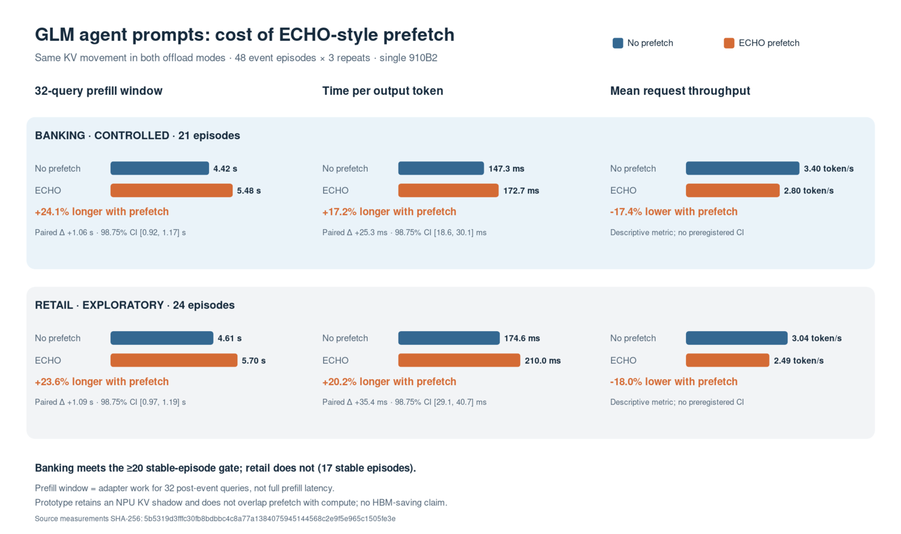

# 单卡 GLM agent 提示中 ECHO 风格预取的性能实验报告

**实验日期：**2026-10-12　**运行编号：**`20261012T1003Z`　**状态：**432/432 次正式请求完成

## 摘要

本实验在一张 910B2 上，以 GLM tiny 和 48 个真实 agent 工具事件提示，比较原生无 offload、相同 KV 搬运但无预取、相同 KV 搬运并启用 ECHO 风格预取三种模式。**主比较是后两者**，以隔离预取策略在这个原型中的额外代价。

银行领域 21 个 episode 满足预设的跨模式原生选择稳定门槛。启用预取后，目标 32-query prefill 窗口开销增加 **1,064.8 ms（24.1%）**，每输出 token 耗时（TPOT）增加 **25.34 ms（17.2%）**；两个预注册差值的 98.75% 双侧区间下界均大于 0。平均请求吞吐从 **3.40 降至 2.80 token/s（−17.4%）**，这是描述性指标。零售全样本也呈下降方向，但仅 17 个 episode 满足稳定门槛，因此其结果属于**探索性**。

这个结论只针对本次顺序执行、保留原生 NPU KV 缓存的 Python 原型。它**不证明**原论文系统、真正异步预取实现或 DeepSeek 上也会下降，更不能据此声称节省 HBM。

[下载 PNG](figures/glm_echo_agent_comparison.png) · [下载 SVG](figures/glm_echo_agent_comparison.svg) · [精确绘图数据](figures/glm_echo_agent_summary.json)

## 1. 问题与实验设计

研究问题是：在 agent 工具事件后的短 prefill 窗口及其后续 decode 中，这个简化的 ECHO 风格 KV 预取实现，相对于承担同样完整分数计算和 KV 搬运的无预取实现，是否增加在线延迟？

| 模式 | 行为 | 在推断中的用途 |
| --- | --- | --- |
| `no_offload` | 使用 vLLM-Ascend 原生 NPU KV 和稀疏注意力 | 环境参考，不参与主差值 |
| `offload_no_prefetch` | 从 pinned CPU KV 向每层 3,072-token NPU scratch 搬运原生选中 KV，并完成保底召回 | 主比较基线 |
| `offload_echo_prefetch` | 使用相同 KV 源、scratch、完整分数计算和保底召回，额外以 256-bin prefill 规则及 α=0.5 的 decode EMA 规则每次预取至多 512 token | 主比较实验组 |

scratch 以 16-token 页打包。适配层重映射真正传给稀疏注意力算子的索引，逐行核对完整候选分数与原生 top-k、scratch KV 内容以及注意力输出；最终需求始终由原生选择决定。目标范围为工具事件后 32 个 prefill query，以及 32-token 固定续写对应的 31 次 decode 注意力调用。

## 2. 环境与工作负载

- **硬件与软件：**物理 910B2 设备 6，进程内映射 `npu:0`；服务器现有 vLLM/vLLM-Ascend 0.23.0；TP=1、BF16、单并发、eager、block size 128、关闭 prefix caching。
- **模型：**`inference-optimization/GLM-5.3-0.6B-A0.4B`，固定 revision `20aae340d157bd2215b9d81165be87e94686dfdf`；权重 SHA-256 `51bba6b768ddcdb97b7595d0b9a3c18cb82c4f8efa77e2f7924c4d1d46cb3aed`。
- **提示：**封存的 τ³ event 分支共 48 个独立 episode，零售与银行各 24 个；GLM tokenizer 重新封存输入 token ID，长度 7,521–32,650。为保证事件后至少 32 个 prefill token，每个提示尾部追加相同的中性 user 消息；原事件边界不变，但提示尾部已改变。
- **输出控制：**每个提示先采集一次 32-token 续写，然后所有模式通过固定 token logits processor 执行完全相同的 token ID 序列。每轮案例顺序一致，模式顺序轮换；三次不计时预热后，48 案例 × 3 模式 × 3 重复，共 432 次正式请求。
- **运行边界：**单 worker，上限 12 小时；实际总耗时 3,910.5 秒，约 65.2 分钟。

## 3. 验收与统计方法

正式运行前，单算子 NPU probe 验证了原生 128-token 页与 16-token scratch 页的注意力等价性；三模式在线烟测也通过。正式 432 次请求的输入和固定输出均通过核对。两种搬运模式**每次请求**各核对 189 行完整候选分数、378 行 KV payload 与注意力；全运行最大注意力绝对误差为 0。manifest、测量文件、分析文件的完成校验和全部通过。现有 CPU 回归通过 169 项，另有 11 项按环境跳过。

主指标为 `offload_echo_prefetch − offload_no_prefetch` 的 `prefill_window_ms` 与 TPOT。每个 episode 先平均三次配对差值，再在每个领域按封存输入长度划为三个等量层，进行 10,000 次分层 bootstrap。四个领域×指标比较分别使用 **98.75% 双侧区间**。只有某领域至少 20 个独立 episode 在全部三次重复的跨模式原生选择一致，才报告稳定子集的受控方向结论；区间下界大于 0 表示有统计支持的方向性延迟增加。无事后百分比门槛。

`prefill_window_ms` 只累计目标 32 个 prefill query 的 indexer 复算和 adapter/scratch 注意力工作，**不是完整模型的 prefill wall time**；原生模式该字段为 0，不能用它与搬运模式比较。TPOT、TTFT 取自在线 vLLM 请求。吞吐定义为每请求 32 token 除以该请求耗时，表中的吞吐为请求均值，未对其做预注册显著性检验。

## 4. 主结果

### 银行：受控比较，21 个稳定 episode

| 指标 | 无预取 | ECHO 风格预取 | 配对差值 | 相对变化 | 98.75% 双侧区间 |
| --- | ---: | ---: | ---: | ---: | ---: |
| 目标 prefill 窗口 | 4,418.48 ms | 5,483.23 ms | **+1,064.75 ms** | **+24.1%** | +915.33 至 +1,174.68 ms |
| TPOT | 147.34 ms/token | 172.68 ms/token | **+25.34 ms/token** | **+17.2%** | +18.63 至 +30.11 ms/token |

两项区间下界均大于 0，故按预设规则，**该原型在银行 agent 提示中出现有统计支持的方向性性能下降**。描述性请求吞吐为 3.40 → 2.80 token/s（−17.4%）；TTFT 均值为 5,067.64 → 6,160.85 ms。

### 零售：探索性比较，全部 24 个 episode

| 指标 | 无预取 | ECHO 风格预取 | 配对差值 | 相对变化 | 98.75% 双侧区间 |
| --- | ---: | ---: | ---: | ---: | ---: |
| 目标 prefill 窗口 | 4,611.33 ms | 5,699.45 ms | +1,088.12 ms | +23.6% | +974.88 至 +1,194.02 ms |
| TPOT | 174.64 ms/token | 210.00 ms/token | +35.36 ms/token | +20.2% | +29.12 至 +40.71 ms/token |

描述性请求吞吐为 3.04 → 2.49 token/s（−18.0%）；TTFT 均值为 5,313.80 → 6,429.83 ms。尽管全样本差值为正，零售只有 **17 个稳定 episode**，低于预注册的 20 个门槛；因此不将这些区间解释为受控性能结论。

### 原生模式参照

在上述同一批银行稳定子集请求中，`no_offload` 的平均 TPOT 为 36.74 ms/token、TTFT 为 489.06 ms、平均请求吞吐为 20.63 token/s；零售全样本分别为 33.13 ms/token、534.00 ms 和 21.28 token/s。它表明此 Python shadow-KV 原型的总开销很高，但原生模式不承担同样的 KV 搬运与核对，**不属于预取策略的主对照**。

## 5. 预取、保底召回与漂移

下表为每次请求的均值，单位 MiB；“未命中”指预取内容在**当前 query**未被原生选择，不代表以后永远不会被复用。

| 子集 | 预取字节 | 当前 query 命中字节 | 当前 query 未命中字节 | 同步召回：无预取 → 预取 |
| --- | ---: | ---: | ---: | ---: |
| 银行稳定 21 episode | 59.95 | 57.35 | 2.60 | 346.21 → 300.36 |
| 零售全部 24 episode，探索性 | 101.13 | 84.68 | 16.46 | 569.61 → 498.27 |

分析保留了 **13 条 case×repeat 跨模式原生选择漂移**，涉及 **10 个案例**；抽查压缩 trace 后确认部分漂移包含实际选中成员变化。银行有 3 个不稳定 episode，零售有 7 个。输入、固定输出、逐模式原生 top-k、KV 和注意力核对均通过，因此这里将 selected-set 漂移单独报告，不把它等同于工程验收失败，也不推定其原因。

## 6. 解释边界与结论

1. 原生 NPU KV cache 始终保留，既供 indexer 使用，也供注意力等价性参照；`prototype_hbm_shadow=true`，**没有 HBM 节省证据**。
2. Python adapter 在当前 query 的完整分数可用后，顺序执行候选预取和保底召回，未与计算异步重叠。命中率及这里的额外时间不能代表融合的异步实现。
3. 续写由固定 token 强制，agent 提示尾部带中性补充消息；这是受控在线请求实验，不是完整自主 agent 会话的端到端吞吐实验。
4. 单张 910B2、GLM tiny、单并发的结果不外推到 DeepSeek、更多并发或论文实现。零售领域因 selected-set 稳定样本不足，只保留探索性方向。

**结论：**在此次 GLM tiny 单卡 agent 提示实验中，这个顺序执行的 ECHO 风格预取原型，相对相同 KV 搬运的无预取基线，在银行稳定子集的 prefill 目标窗口和 TPOT 上均出现有统计支持的延迟增加；平均请求吞吐下降 17.4%。零售全样本方向相同，但不能给受控结论。

## 7. 数据与复核

- 运行输出（服务器）：`/root/echo-glm-formal-20261012T1003Z/`；本地忽略目录：`m0a/runs/glm_formal_20261012T1003Z/`。
- 输入封存 SHA-256：`1aae432308d41fc7b5eec5b211aa66ca344a207b60166b58d019ecf397360083`；432 请求调度 SHA-256：`27942f06b3ed97e308455143333d70ccf69164722a40482493b7aeb34282f3b7`。
- 正式测量 SHA-256：`5b5319d3fffc30fb8bdbbc4c8a77a1384075945144568c2e9f5e965c1505fe3e`；分析文件 SHA-256：`730e04b1013cd17a028f4fca670e855fdd2dba840393eee5801f7e74d3481544`。
- [预注册分析代码](../m0a/glm_online_stats.py)和[图表生成代码](../m0a/plot_glm_online_results.py)均在仓库中；运行 manifest 记录模型文件与运行代码哈希。图表生成器从原始测量重新计算各组均值并校验完成标记。
