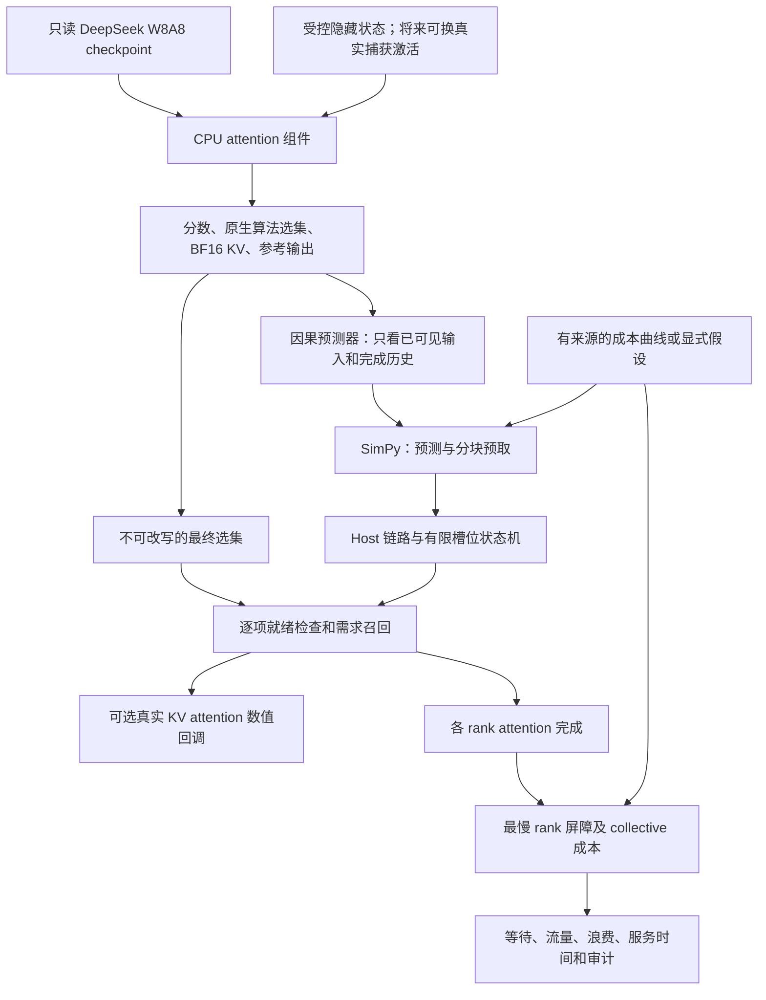

# issue6：DeepSeek 模拟器机制、必要验证项与八卡实验边界

2026-10-27 补充：[本轮 CPU 验收、长上下文结果与逐项状态](issue6-cpu-acceptance-20261027.md)。下文保留 2026-10-22 实验口径。

更新日期：2026-10-22。目标模型：共享只读目录 `/models/DeepSeek-V4-Flash-W8A8`。本次依据 [issue6 原文](https://github.com/intellistream/memory-aware-sparse-kv/issues/6)，快照见 [requirements snapshot](issue6-requirements-snapshot-20261022.json)。

## 1. 首先明确要证明什么

issue6 的假设是：**用预测时已可见的信息，在原生 indexer 给出最终选集之前搬运 KV，减少同步回载等待；同时不改变原生选择和模型输出。** 选集重叠率高、CPU 检查通过、模拟器中出现收益，分别只是这条证据链的一部分。

本项目现在有两种可执行模拟能力：真实 checkpoint 注意力组件的 CPU 数值参考，以及基于真实权重选集的异步缓存/逻辑 rank 时间线模拟。它们适合在无八卡时排除错误方案、检查数据依赖、比较预算与链路瓶颈、制定实机实验。它们还不能独立完成 issue6 的真实 Agent 泛化和在线性能验收。

需分开使用三类结论：

1. **机制正确性**：所需 KV 是否在读取前就绪，缓存是否越界，召回后 attention 是否与基线相同。当前 CPU 模拟能够验证相应实现。
2. **方法有效性**：预测信号是否能覆盖真实 DeepSeek Agent 的需求，是否能泛化到新任务、新领域。需要真实输入激活/原生选集和独立任务划分；受控隐藏状态不能替代。
3. **系统收益**：完整 TTFT、TPOT、显存峰值、吞吐是否改善。需要全模型依赖图、目标设备校准，以及最终八卡在线对照；单层时延不能乘 43 后冒充整模型结果。

## 2. 使用 DeepSeek 验证 issue6 必不可缺的项目

“必要”以待证明的结论为准。前六项是正确性与调度机制的最低闭环；后四项是声称真实方法有效、全模型加速所必需的证据。

| 必要项目 | 不可省略的内容 | 当前状态 | 对应任务 |
| --- | --- | --- | --- |
| 真实选集产生 | DeepSeek 的 SWA、C4/C128 压缩、indexer、RoPE、sink、top-k；原生选择最终生效 | 已有真实权重 CPU 组件；输入仍为受控隐藏状态；未与 NPU kernel 对齐 | 1、4、19 |
| 预测因果性 | 命名空间、完整前驱、可见信号及到达时刻；只观察已完成 query；oracle 单列 | 协议与历史预测器已实现；当前分数信号不得早于 native ready | 1、5–10 |
| Host/设备状态 | 缓存容量、在途占位、淘汰、缺失召回、本地新生 KV、H2D/D2H、版本隔离 | 新增显式状态机、写穿 Host、按需取回与失效检查；设备为逻辑槽位 | 18、19 |
| 数值与功能正确性 | 必需 KV 完整；attention 前就绪；attention/输出与完整 KV 基线对照 | CPU 稀疏/掩码参考及真实张量回调通过；全模型 logits/工具行为未验证 | 19 |
| 重叠及资源竞争 | 预测开销、搬运启动、带宽、块大小、计算并行、需求优先、在途不可抢占 | 新增块级异步调度；共享或独立 Host 链路；时间参数尚为假设 | 18、20 |
| 公平对照与完整账本 | 相同容量/预算；无预取、历史、上一选集、oracle；浪费、等待、总流量和内存 | 六类配置、五种策略；新生 KV 回写计费；完整 indexer 与非 C4 KV 纳入内存估算 | 5、6、10、20 |
| 真正的工作负载 | DeepSeek 自主 Agent、银行/零售、任务族拆分、长度控制、事件类型及变体合法性 | 本次没有新增真实 Agent 运行；不能把受控原型切换称作工具事件或泛化验证 | 2–4、11–17 |
| 全模型/八卡依赖 | 43 层、mHC、MoE 路由、TP/EP 映射、collective、最慢 rank、prefill/decode 和调度 | 新增逻辑 rank 屏障与简化 collective；尚未实现完整依赖图和 MoE 通信 | 18、20 |
| 成本校准 | 指定设备/软件/精度/形状的算子、H2D/D2H、HCCL、预测器维护耗时；留出样本误差 | 新增带来源的成本曲线接口；没有实测 Ascend 校准数据 | 10、18、20 |
| 可追溯性 | 模型/权重/源码/trace 哈希、配置、种子、失败结果、可复算日志 | 已保存快照、哈希、原始事件、测试与审计；不会将模拟结果标成原生 trace | 4、21 |

ECHO 风格基线需要完整分数及其实际可见时间。原协议的 C4 selected-only trace 不足以认证 faithful ECHO。本轮五种策略未把普通历史策略改名为 ECHO；`current_scores` 仅用于时序机制测试。前轮保存的组件分数可以支持后续受控 ECHO 实验，但仍不是原生八卡采集。

## 3. 开源模拟器如何使用

本次重新核对了项目官方资料。这里的“借鉴”表示采用建模思路，**不表示已经调用或运行了该项目**；直接运行的第三方仿真依赖只有 SimPy 4.1.1。

| 开源项目 | 主要能力 | 对本项目的作用与采用程度 | 不能直接代替的部分 |
| --- | --- | --- | --- |
| [SimPy](https://simpy.readthedocs.io/en/latest/topical_guides/resources.html) | 离散事件、优先级资源、队列与事件依赖 | **已实际使用** Environment、PriorityResource、Event、AllOf，驱动缓存与链路状态 | 不理解 DeepSeek 结构，也不产生真实算子耗时 |
| [Vidur](https://github.com/microsoft/vidur) / [profiling 文档](https://github.com/microsoft/vidur/blob/main/docs/profiling.md) | 算子 profiling 驱动的推理系统性能模拟 | 借鉴计算/通信分开校准，新增带来源的插值成本曲线 | 官方列出的模型/设备表未提供本项目 V4 W8A8 + Ascend 的现成配置；不能移用 A100 时延 |
| [SimAI](https://github.com/aliyun/SimAI) | 计算通信系统模拟；当前文档已有 DeepSeek 推理、多请求和内存建模 | 借鉴资源竞争、rank 同步、计算与通信分层；适合将来接入更完整网络模型 | “支持 DeepSeek”不能推定已复现 V4 的 C4 indexer 或 Ascend HCCL；本次未运行其后端 |
| [ASTRA-sim](https://github.com/astra-sim/astra-sim) | 分布式工作负载、collective 和网络依赖建模 | 作为未来复杂拓扑/通信调度后端候选；当前只有简化 ring 成本 | 不提供本项目的真实 KV 数值或 Agent 选集 |
| [LLMCompass](https://github.com/PrincetonUniversity/LLMCompass) | 硬件/算子映射与分析模型 | 可用于将来交叉核对计算、带宽和内存约束；本次加入显式内存账本 | 不能将其其他硬件上的误差或速度直接用于 V4/Ascend |

现阶段保留小型、可审计的 SimPy 核心更合适：issue6 要验证的是特定稀疏 KV 数据依赖，迁移到大型系统模拟器仍然需要实现这部分。后续可将外部模拟器结果转换成统一成本曲线；目前没有宣称兼容其原生 workload/Chakra 格式，也没有接入 ns-3 或 SimCCL。

## 4. 当前代码分层与数据流



| 文件 | 责任 |
| --- | --- |
| `m0a/deepseek_v4_cpu.py` | 读取实际 attention 权重；执行 SWA、C4/C128、indexer、attention 与输出投影 |
| `m0a/run_deepseek_v4_cpu.py` | 前轮五组数值实验，保存选集、分数、输出和权重凭据 |
| `m0a/issue6_protocol.py` / `issue6_predictors.py` | 不可变预测输入、命名空间、已完成观察与已有预测策略 |
| `m0a/issue6_simulator.py` | 保留旧版整批预取排空的保守时序模型，旧实验仍可复现 |
| `m0a/issue6_async_simulator.py` | 本次新增的异步状态机、逻辑 rank 同步、成本曲线和内存账本 |
| `m0a/run_issue6_async_study.py` | 真实权重 trace 回放、六种配置扫描、实际 BF16 KV 回调验证 |
| `m0a/summarize_issue6_async.py` | 哈希、因果时刻、流量、屏障、状态转移审计及绘图 |
| `m0a/test_issue6_async_simulator.py` | 可解析时延及缓存安全的边界测试 |

### 4.1 数值组件模拟的是数学运算

读取模型实际维度和权重：隐藏维 4096、64 个 attention head、head dim 512、indexer 64×128、SWA 128、C4 top-k 512。C4 采用学习的投影/门控和重叠压缩，C128 保留所有已完成压缩块；indexer 的加权 ReLU 分数决定 C4 选集。attention 同时读取滑动窗口和压缩 KV，包含 sink 与输出投影。

INT8 权重按实际 scale 解码，核心累加为 FP32，KV 为 BF16；可选动态 INT8 参考只用于量化敏感性检查。它不是 Ascend kernel 的逐位模拟。第 0、2、3 层分别验证，没有串成完整网络。原型加噪声产生的隐藏状态缺少上游 43 层、mHC/MoE 和真实语义分布。详见 [组件实验报告](issue6-deepseek-cpu.md)。

### 4.2 异步状态与容量

每个 `(task, run, request, context_version, rank, layer, phase)` 有独立缓存。一个槽位经历：

```text
absent → reserved → inflight → ready → attention_read / evicted
                         └→ invalid（对应上下文已经失效）
```

预留和在途槽位都计入容量，尚未完成 DMA 的数据不能读取或被覆盖。当前选集在 attention 结束前被保护。同一 KV 已有在途请求时，需求侧等待该请求而不重复传输。版本切换使旧缓存失效；调度器等待旧在途分配结束后才复用该命名空间的预算，晚到数据不能发布到新版本。

预取按固定最大单元数分块，默认每块 64 个 1024-byte C4 单元。需求只打包真正缺失的 ID，已驻留 ID 不额外收费；这隐含可批量 gather/pack 的传输接口，其实际打包开销仍需校准。原生选集就绪后停止提交后续推测块，已提交的块不可抢占；需求请求在共享队列中优先于尚未开始的预取。选集就绪不等于立即开始 attention：必须等待其中每个 KV 进入 ready。

每 4 token 新生成的压缩 KV：若当前被选中则直接本地就绪，不计 H2D；同时显式向 Host 写穿并计 D2H。未选中的新单元使用压缩器暂存区，不挤占受保护选集。当前实现保守地等待写穿结束再进入下一 query，保证后续 Host 取回有有效副本。它尚未模拟脏页批量淘汰或延迟写回策略。

### 4.3 时间、重叠和八个逻辑 rank

历史信号在配置的信号延迟之后可用，再加预测开销；当前分数信号最早为 native ready；oracle 明确带当前标签，仅作诊断。一次搬运的默认成本为：

`T_DMA = launch_us + bytes / (bandwidth_GBs × 1000)`，单位为 μs。

native、搬运和 attention 按事件依赖推进，CPU 执行 Python 的墙钟时间不作为设备时延。需求流量可与其他 rank 的预取争用 Host 链路。支持共享单链路和每 rank 独立链路两种假设，H2D/D2H 默认共享对应链路。它们是拓扑边界场景，不是已探测的机器布线。

一个 step 等待所有 rank 完成，再加 collective 成本。默认 ring all-reduce 分析式为：

`T_collective = 2(r−1)α + 2(r−1)/r × bytes / (BW × 1000)`。

这是消息成本和同步依赖模拟，不执行跨 rank 数值归约。可给个别 rank 施加慢速因子以检查尾延迟。当前 native/attention 耗时是每 rank 的配置值，不是从真实 head/专家分片自动推导；MoE all-to-all、HCCL 算法、物理链路共享及全模型层间重叠尚未实现。

本次八 rank 使用同一层 C4 选集的显式副本场景，manifest 标记 `identical_selected_C4_KV_replica_fixture_not_native_rank_capture`。这检查“各卡 KV 副本搬运争用 + 最慢卡屏障”的机制，不能认证实际 TP/EP 布局。

预测进程目前假设有独立 CPU 执行资源，尚未建立 CPU 线程池争用、Host gather/pack 与内存带宽竞争模型。迟到的预测会被取消预取提交，可能不增加 decode 关键路径，但仍记入排空时间 `drained_us`；这不代表预测计算没有 CPU 成本。零提前量场景因此可以与无预取相同。

### 4.4 内存账本

按配置中的 43 层计算：平衡分片假设下的权重、各层 SWA、有限 C4 槽位、全部 C128 KV、**全量 indexer 压缩缓存及 scale**、压缩器状态上界、工作区和安全余量。C4 设备端完整 shadow 不计入性能账本；Host 的完整 C4 副本单独列出。

默认示例假设每 rank 64 GiB、8 GiB 工作区、4 GiB 余量，扫描上下文 4K/8K/32K/128K 及 1/16 请求。显式的 OOM 判断是这些假设下的算术约束。它没有测量实际 allocator、高水位、权重不均匀分片、workspace 或碎片，不能当作“八卡一定装得下”的结论。多请求这里只扩展内存账本，时间模拟仍是顺序 query 的单请求 rank 组，不是 continuous batching。

### 4.5 成本曲线接入与校准

`CostProfile` 支持 `h2d/d2h/native/attention/prediction/collective`。曲线按 size 线性插值，拒绝区间外外推。文件必须标注模型、设备标签、并行 rank 数、来源及 provenance；非假设数据必须有来源 SHA256。模型/设备/rank 不匹配会报错。缺失的操作继续使用明确标为 assumed 的默认值，不能把部分校准当作全部实测。

这是**自定义归一化成本接口**，不是 Vidur/SimAI 的原生导入器。完整格式示例见 `m0a/issue6-cost-profile.example.json`。其中数值全部是教学假设，不能改个标签就作为测量。`source_sha256` 记录来源声明，文件本身无法证明采集真实性；接入实机数据时必须随包保存原始采样日志。

实机校准应记录：型号与拓扑、TP/EP、checkpoint、驱动/CANN/框架版本、精度、batch/长度/块大小、是否 pinned、算子融合、热身和重复次数。以独立形状/负载作留出校验，报告误差分布；并发下的 H2D/compute/collective 争用需要联合测量，不能仅相加孤立峰值带宽。目前没有这组校准数据，所以所有输出服务时间仍为模拟条件结果。

## 5. 与真实八卡运行的区别

| 方面 | 当前模拟器 | 真实八卡 DeepSeek |
| --- | --- | --- |
| 输入 | 人工构造层隐藏状态或保存的选集 | tokenizer、真实 prompt、历史生成和工具返回 |
| 模型执行 | 选定 attention 组件，或选集事件回放 | embedding、43 层、mHC、MoE、输出头与采样 |
| 稀疏选择 | checkpoint 数值参考生成；最终标签固定 | 实际 NPU indexer/kernel 产生，需采集并稳定性检查 |
| 精度 | FP32 参考、BF16 KV、近似 INT8 | 实际 W8A8、融合算子与设备累加/排序行为 |
| KV | CPU tensor 复制或逻辑 ID/槽位 | Host pinned memory、实际 HBM 地址及异步 DMA |
| 多卡 | 逻辑 rank 副本、简化同步及 ring 成本 | TP/EP 分片、HCCL、物理互连、MoE 路由及尾延迟 |
| 时间 | 假设曲线/外部成本，按事件推进 | 设备事件、流同步、排队、调度与实际系统开销 |
| 内存 | 明确假设的静态账本 | allocator、临时 buffer、碎片、实际峰值和 OOM |
| 输出一致性 | 组件输出相同 | logits、生成 token、工具决策及任务指标核验 |
| 可报告指标 | rank 组服务时间、等待、流量、浪费、逻辑槽位 | 完整 TTFT/TPOT、吞吐、任务成功率和实际峰值显存 |

因此：八 rank 不等于八卡执行；真实权重不等于真实输入分布；稀疏 gather 与 dense-mask 一致不等于原生 NPU 对齐；模拟数据中没有 full device shadow 不代表在线实现已移除 shadow。

## 6. 可复现入口与结果解释

远端工作目录：`/root/experiments/issue6-simulator-v2-20261022/`；原固定环境 `/root/experiments/memkv-env-89df7fad/code` 未改动。CPU 依赖沿用 `m0a/deepseek-v4-cpu-requirements.txt`。

```bash
cd /root/experiments/issue6-simulator-v2-20261022/code
PY=/root/experiments/issue6-simulation-20261022/venv/bin/python
export TORCH_DEVICE_BACKEND_AUTOLOAD=0
"$PY" -m unittest m0a.test_issue6_async_simulator m0a.test_issue6_simulator m0a.test_deepseek_v4_cpu -v
"$PY" -u -m m0a.run_issue6_async_study \
  --source /root/experiments/issue6-dsv4-cpu-20261022/run-r01 \
  --model-dir /models/DeepSeek-V4-Flash-W8A8 \
  --output ../study-NEW --verify-payloads
"$PY" -m m0a.summarize_issue6_async ../study-NEW
```

离线归档包含 `inputs/cpu-run-r01` 时可将 `--source` 改为该路径。不加 `--verify-payloads` 可只做事件回放，此时 `--model-dir` 可指向归档的 `inputs/model-metadata`，只读取权重索引以估算总权重字节，完全不需要 NPU 或模型权重文件。实际数值回调仍需要共享 checkpoint。输出目录必须是新目录，避免覆盖旧实验。

场景包含 4096 稳定原型、8192 原型切换两条 trace；六种配置 × 无预取/上一选集/全局频率/阶段频率/oracle 五种策略，共 60 组。它们是配置扫描，不是 60 个独立 Agent 任务，因此不报告任务级置信区间或泛化结论。默认 C4 容量/预算 512，另有容量 1024 场景；默认 DMA chunk 64、带宽 16 GB/s、启动 5 μs、预测 5 μs、native 50 μs、attention 20 μs；collective 用 8192 bytes、100 GB/s、α=1 μs。所有配置完整写入 manifest。

结果文件：`manifest.json`（配置、来源和汇总）、每场景 `.json.gz`（完整传输及 rank 时间线）、`payload-*.json.gz`（实际张量回调的状态转移）、`audit.json`（独立审计）、`service-reduction.png`、`rank-timeline.png`。`mean_group_service_us` 不能改名为 TPOT；`prefetch_overlap_rank_sum_us` 是跨 rank 重叠之和，不能当作端到端节省时间。

oracle 带当前标签，并仍受相同容量、带宽、分块和预测开销约束，只是选择信息诊断。它不是所有调度策略的数学最优延迟上界。

### 6.1 最终运行结果（study-r02）

45 项测试通过：新增异步机制 17 项、旧系统模拟 13 项、数值组件 15 项。60 组配置扫描和 2 组实际张量回调均完成。独立审计通过，核对了 62 个结果文件、8656 个 rank-query 记录、44035 次传输、22388 条实际张量回调状态转移和 14 个执行源码哈希。

两种策略各 8 个 query 的 BF16 KV 经过新异步状态机取回，再执行真实权重 attention；共 16 次投影输出与前轮保存的 CPU 基线完全相同，最大绝对差为 0。另核对了本轮读取的 26 个 checkpoint 张量与原权重凭据相同。这里比较的是同一 CPU 算法；不扩大为全模型或 NPU 一致性结论。

以下服务时间减少率以相同场景的无预取为基准；负值表示变慢。它们是**当前假设下单层 rank 组**的结果。

| 受控 trace | 场景 | 全局频率 | oracle 诊断 |
| --- | --- | ---: | ---: |
| 4096 稳定原型 | 单 rank，提前 50 μs | +0.49% | +9.16% |
| 4096 稳定原型 | 八 rank 共享 Host 链路 | −10.04% | −6.48% |
| 4096 稳定原型 | 八 rank 独立 Host 链路 | +0.43% | +8.04% |
| 8192 原型切换 | 单 rank，提前 50 μs | −9.33% | +5.94% |
| 8192 原型切换 | 八 rank 共享 Host 链路 | −15.27% | −9.98% |
| 8192 原型切换 | 八 rank 独立 Host 链路 | −8.15% | +5.19% |

这组对照说明：忽略链路共享，可能把单 rank 的小收益误判成多卡收益；知道正确选集也不自动得到最优预取时间，因为缓存保护、分块、额外传输和队列顺序仍影响结果。实际硬件是否出现同样趋势，需要拓扑与成本校准。

旧组件实验和旧整批排空模型的数字仍保存在各自报告中。新模型改变了分块、停止提交、需求打包和 D2H 计费方式，不能把两版数值差直接解释成模型优化实测收益。

一键入口：`bash scripts/run_issue6_simulator_v2.sh <CPU结果目录> <全新输出目录>`，可用 `PY` 和 `MODEL_DIR` 环境变量指定解释器及模型路径。

## 7. 获得八卡后如何补齐证据

1. **固定来源与部署**：读取实际 TP/EP、物理/逻辑卡映射和软件版本；保留当前 checkpoint 哈希；不继承旧资源的卡号或 SSH 端口。
2. **先做原生采集对照**：在同输入上重复运行，捕获对应层输入、indexer 分数/选集和压缩 KV；检查 CPU 参考与原生结果的差异，先确定精度及采集位置。
3. **校准时序与内存**：实测各算子、预测器维护、H2D/D2H 和 HCCL，捕获完整层/专家依赖、设备驻留和峰值；保存留出校验误差。
4. **接入真实缓存路径**：相同容量/预算下先无预取、再历史预测；使用设备事件证明重叠；性能路径移除 full KV shadow，并单独运行正确性检查，避免重复计算污染性能。
5. **真实 Agent 和泛化**：银行/零售固定任务族划分；覆盖任务 11–17；记录工具行为和事件来源。检查 logits/输出/任务成功率，再报告完整 TTFT/TPOT、等待、浪费流量和内存。

上述第 2–5 步完成前，issue6 的 18–20 项只能写“模拟准备/机制验证”，不能写“真实在线验收完成”。
